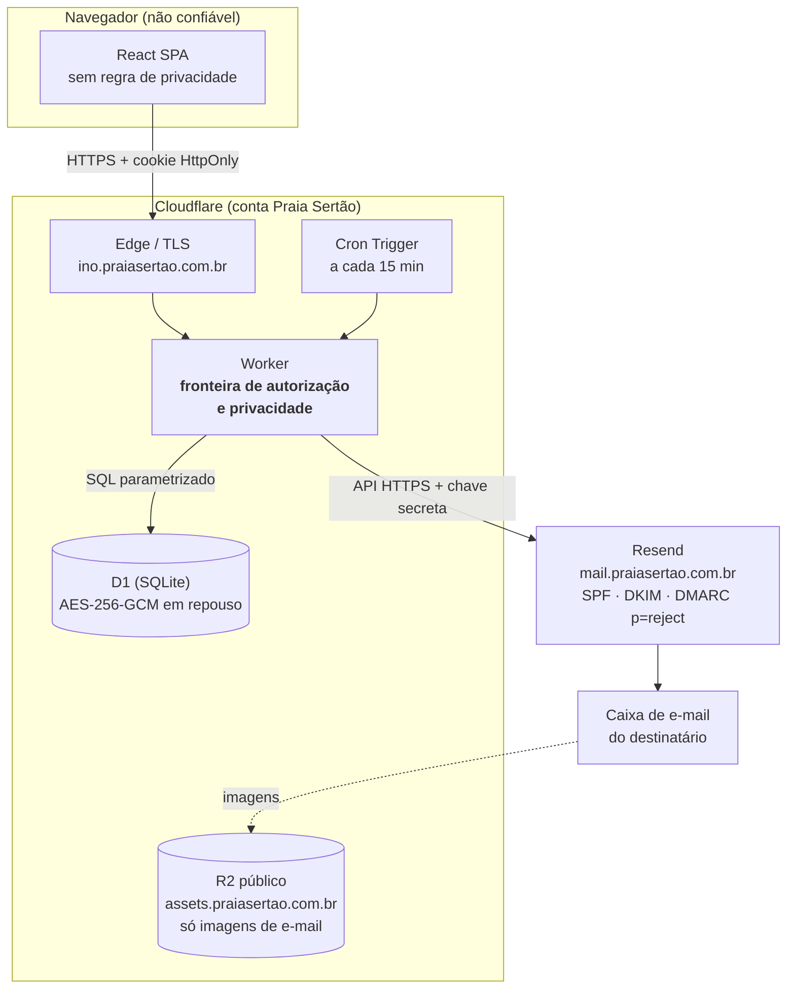
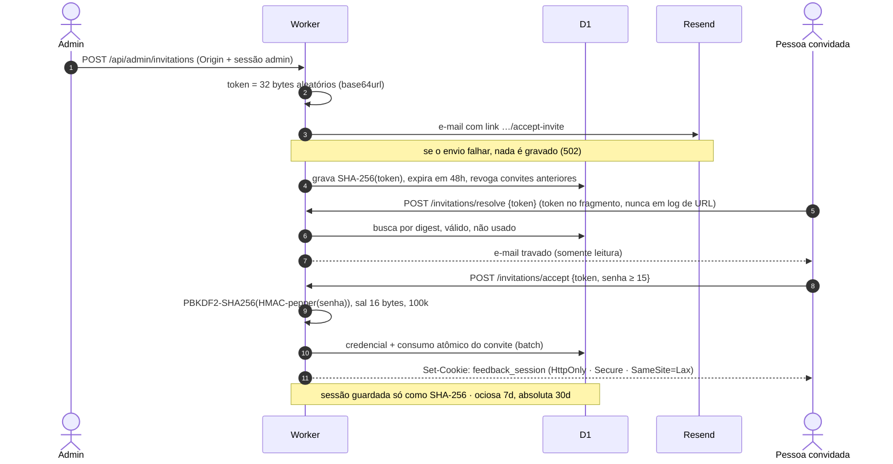
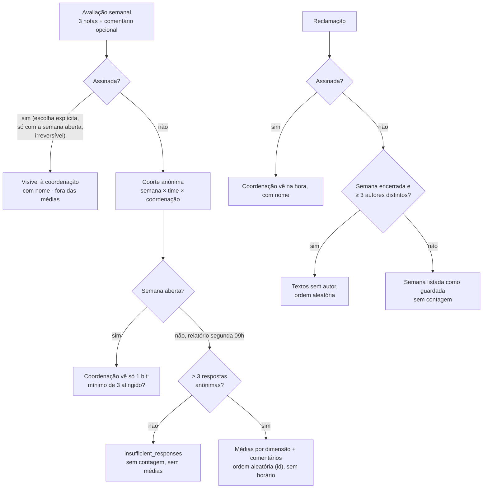

# ino: arquitetura de segurança e privacidade

> Documento técnico · Segurança da informação · **Uso interno**
>
> Como a plataforma de feedback da Praia Sertão autentica pessoas, autoriza cada requisição, protege o anonimato das respostas e trata os dados. Inclui os riscos conhecidos e as recomendações abertas.

| | |
|---|---|
| **Sistema** | ino — https://ino.praiasertao.com.br |
| **Versão do código** | branch `dev`, commit `085d462` |
| **Data** | 10 de novembro de 2026 |
| **Responsável** | Ariel Cavalcante |
| **Referências** | `docs/PRIVACY.md`, `docs/DECISIONS.md` (ADR-001 a ADR-030), `AGENTS.md` |

Uso interno. Descreve controles implementados no código. Pontos que dependem de configuração da conta Cloudflare ou de processos estão marcados como tal.

<!-- Mantenha este documento em sincronia com o código: atualize-o (e a versão/data acima) sempre que a documentação for atualizada. -->

## Sumário

1. [Resumo executivo](#01-resumo-executivo)
2. [Arquitetura e fronteiras de confiança](#02-arquitetura-e-fronteiras-de-confiança)
3. [Identidade e autenticação](#03-identidade-e-autenticação)
4. [Autorização](#04-autorização)
5. [Modelo de anonimato](#05-modelo-de-anonimato)
6. [Proteções da aplicação web](#06-proteções-da-aplicação-web)
7. [Dados, criptografia e segredos](#07-dados-criptografia-e-segredos)
8. [E-mail](#08-e-mail)
9. [Logs e auditoria](#09-logs-e-auditoria)
10. [Desenvolvimento seguro](#10-desenvolvimento-seguro)
11. [Riscos conhecidos e recomendações](#11-riscos-conhecidos-e-recomendações)
12. [Apêndice: rotas da API](#a-apêndice-rotas-da-api)

## 01. Resumo executivo

O ino é uma aplicação web interna para avaliações semanais da coordenação, reclamações e registro de conversas 1:1. Ela roda inteira na Cloudflare: um Worker serve a interface e a API, e o banco é o D1. Os e-mails transacionais saem pelo Resend.

- **Acesso só por convite.** Os tokens são aleatórios de 256 bits, de uso único, expiram em 48 h e ficam guardados só como hash SHA-256. Não existe cadastro público nem login social.
- **Senhas** com mínimo de 15 caracteres, guardadas com PBKDF2-HMAC-SHA256 e salt individual, mais um *pepper* que fica num segredo do Worker. As sessões são opacas, guardadas como hash e enviadas em cookie `HttpOnly` / `Secure` / `SameSite=Lax`.
- **O Worker é a única fronteira de autorização.** Toda rota protegida confere a sessão, o perfil (admin, coordenação, colaborador) e o escopo de equipe. A interface não aplica nenhuma regra de segurança.
- **O anonimato é garantido no servidor.** Resultados só saem com pelo menos 3 respostas anônimas. A coordenação nunca recebe autoria, horário nem ordem de envio. Identificar-se é uma escolha explícita e irreversível, item a item, e o que é assinado sai das médias.
- **Mínimo de dados fora do banco.** E-mails, logs e auditoria não carregam respostas, notas nem textos.
- **Lacunas principais:** não há MFA para administradores; o fator de trabalho do PBKDF2 está abaixo do recomendado pela OWASP; a atribuição confidencial fica no banco, acessível a quem tem acesso à conta Cloudflare; falta CSP; a retenção de dados não é automatizada. Detalhes na seção 11.

## 02. Arquitetura e fronteiras de confiança

*Figura 1. Componentes e fluxos. O navegador e o provedor de e-mail são não confiáveis para conteúdo sensível. Toda regra de autorização e de privacidade vive no Worker.*

| Componente            | Papel                                                                                                                   | Observações de segurança                                                                                                             |
|-----------------------|-------------------------------------------------------------------------------------------------------------------------|--------------------------------------------------------------------------------------------------------------------------------------|
| **Cloudflare Worker** | Serve a SPA (assets estáticos) e a API `/api/*` (rodada antes dos assets). É a fronteira de autorização e privacidade.  | Sem servidores próprios. Atualizações via `wrangler deploy` a partir do repositório.                                                 |
| **Cloudflare D1**     | Banco relacional (SQLite) com usuários, sessões, ciclos, respostas, reclamações, conversas, fila de e-mail e auditoria. | Criptografado em repouso (AES-256-GCM, chaves gerenciadas pela Cloudflare) e TLS em trânsito. Acesso direto só via conta Cloudflare. |
| **Cron Trigger**      | A cada 15 min: cria, abre e fecha os ciclos semanais, inclui os participantes e despacha a fila de e-mails.             | Idempotente: unicidade por (agenda, sequência) e chaves únicas por job.                                                              |
| **R2 público**        | Hospeda só as 3 imagens do template de e-mail (`assets.praiasertao.com.br`).                                            | Nenhum dado pessoal. Não usa o domínio `r2.dev`.                                                                                     |
| **Resend**            | Envio de convites, redefinição de senha e avisos semanais.                                                              | Recebe só endereço, nome e texto genérico. Domínio com SPF, DKIM e DMARC `p=reject`.                                                 |
| **Navegador**         | SPA React. Não guarda tokens acessíveis a JavaScript.                                                                   | Sem analytics, sem scripts de terceiros. Fontes servidas pelo próprio domínio.                                                       |

## 03. Identidade e autenticação

*Figura 2. Convite, criação de senha e emissão de sessão.*

### Convites e redefinição de senha

- Token de 32 bytes do `crypto.getRandomValues`, em base64url. O banco guarda só `SHA-256(token)`.
- O token vai no **fragmento** da URL (`#token=`), que não chega aos logs do servidor nem ao Referer. A SPA remove o token da barra de endereço.
- Validade: convite 48 h, redefinição 30 min. O consumo é atômico e condicional (`UPDATE … WHERE accepted_at IS NULL AND expires_at > now`), e um novo convite revoga os anteriores.
- O e-mail fica preso ao convite no servidor: ele nunca vem da URL nem do formulário.
- A redefinição revoga todas as sessões. O pedido de redefinição responde sempre igual, exista ou não a conta.

### Senhas

- Mínimo de 15 caracteres e máximo de 128, contados em pontos Unicode. Sem regras de composição, sem troca periódica e sem truncamento silencioso.
- Formato versionado: `$pbkdf2-sha256$i=100000$salt$hash`. Salt de 16 bytes, derivação de 32 bytes.
- Antes do PBKDF2, a senha passa por um **HMAC-SHA256 com pepper** (segredo `AUTH_PEPPER`, fora do banco).
- Comparação em tempo constante. No login com usuário inexistente, o servidor executa um hash fictício, pra que o tempo de resposta não revele se a conta existe.
- A lista de senhas bloqueadas ainda é mínima (ver R6).

### Sessões

- Token opaco de 256 bits. O banco guarda só o SHA-256.
- Cookie `feedback_session` com `HttpOnly`, `Secure`, `SameSite=Lax` e `Path=/`.
- Expiração por inatividade em 7 dias (renovada no máximo uma vez por dia) e absoluta em 30 dias.
- Revogação no logout, na redefinição de senha e na desativação da conta, que também revoga convites e links de redefinição pendentes.

### Proteção contra força bruta

- Limite de 10 tentativas de login a cada 15 min, por identidade e por IP (`CF-Connecting-IP`). A redefinição de senha tem limite de 5 a cada 15 min.
- As chaves do limitador são `SHA-256(pepper | tipo | valor)`: nem o e-mail nem o IP ficam guardados em claro.
- As mensagens de erro são genéricas ("e-mail ou senha incorretos").
- O primeiro admin é criado por um comando de operador (`admin:bootstrap`), sem endpoint público.

## 04. Autorização

O modelo é RBAC com perfis acumuláveis (`admin`, `coordinator`, `employee`), guardados em `user_roles` com histórico de concessão e revogação. Cada handler chama `requireRole` e aplica o escopo do recurso na própria consulta SQL. Esconder elementos na interface é só apresentação.

| Perfil          | Pode                                                                                                                                                                                              | Escopo aplicado no servidor                                                                                                                                             |
|-----------------|---------------------------------------------------------------------------------------------------------------------------------------------------------------------------------------------------|-------------------------------------------------------------------------------------------------------------------------------------------------------------------------|
| **Colaborador** | Responder a avaliação da semana (uma vez), assinar até o fechamento, reclamar, ver o próprio histórico (feita / não feita), as próprias avaliações assinadas e as anotações de conversa sobre si. | Sempre o próprio `user.id`. A participação vem do snapshot de elegibilidade do ciclo.                                                                                   |
| **Coordenação** | Ver resultados agregados do time, avaliações e reclamações *assinadas*, reclamações anônimas liberadas, e registrar ou editar anotações de conversa.                                              | Coortes filtradas por `coordinator_user_id` do snapshot. Pessoas e conversas só de equipes que coordena hoje. A edição de uma conversa exige ser o autor.               |
| **Admin**       | Convidar, editar perfis e equipe, desativar ou reativar pessoas, gerenciar equipes e coordenação, pausar ou retomar as avaliações.                                                                | **Nenhum acesso** a respostas, notas, comentários ou reclamações. Não pode remover o próprio perfil de admin nem se desativar, o que garante pelo menos um admin ativo. |

> **Testes de autorização:** a suíte de integração roda a API inteira contra as migrações reais e confere 403/404 para colaborador chamando rotas de admin e de coordenação, coordenação editando conversa de outra pessoa, registro de conversa com quem não é do time e payloads sem campos de identidade.

## 05. Modelo de anonimato

"Anônimo" no ino significa que o sistema guarda a atribuição de forma confidencial (para elegibilidade, deduplicação e lembretes), mas nenhuma tela, API, e-mail ou log entrega a autoria de algo não assinado a coordenação, colegas ou administração.

*Figura 3. Projeções aplicadas pelo Worker antes de qualquer dado chegar à coordenação (`worker/domain/coordinator.ts` e `complaints.ts`).*

### Invariantes implementados

- **Limiar k = 3** por coorte (semana × time × coordenação), com piso fixo de 3 mesmo que a configuração seja menor. Abaixo do limiar, a resposta é `insufficient_responses`, sem contagem, médias nem comentários.
- **Semana aberta:** a coordenação recebe um único bit (o mínimo foi atingido?), nunca a contagem (ADR-023).
- **Comentários e reclamações** anônimos saem em ordem de id aleatório (UUID), sem horário. As reclamações contam *autores distintos*, não quantidade de reclamações, e só são liberadas após o fim da semana (segunda, 09:00).
- **Assinar** é opt-in por item. Só é possível com a semana aberta e é irreversível. Itens assinados ficam **fora** de todas as contagens e médias anônimas. Isso impede a dedução por subtração: assinar depois do resultado, ou desassinar depois de visto, permitiria calcular a resposta de quem não assinou.
- **Respostas anônimas não voltam nem pro autor.** Isso evita coerção do tipo "me mostra o que tu respondeu".
- **Snapshot imutável** de elegibilidade por ciclo: mudar de equipe não altera coortes passadas, e ninguém entra duas vezes no mesmo ciclo.
- **A auditoria de reclamação** registra o ator sem o id do recurso, então o log não liga a pessoa ao texto anônimo.
- **Reclamações não têm tema de liderança.** Feedback sobre a coordenação vai pela avaliação, que é protegida pelo limiar.

> **Limite do modelo:** com k = 3, quem respondeu conhece a própria nota e, junto com a média, pode estimar a soma das outras duas. Isso é inerente a médias em coortes pequenas e foi aceito para um time de cerca de 6 pessoas. Aumentar k ou trocar médias por faixas reduz o risco, mas atrasa os resultados.

## 06. Proteções da aplicação web

| Controle               | Implementação                                                                                                                                                                                                                                                                                       |
|------------------------|-----------------------------------------------------------------------------------------------------------------------------------------------------------------------------------------------------------------------------------------------------------------------------------------------------|
| CSRF                   | Toda requisição que não é GET exige `Origin` igual a `APP_ORIGIN`, um valor fixo. Junto com o cookie `SameSite=Lax`. Rotas GET são só leitura.                                                                                                                                                      |
| Cabeçalhos HTTP        | `X-Content-Type-Options: nosniff`, `Referrer-Policy: no-referrer`, `X-Frame-Options: DENY`, `Permissions-Policy` negando câmera, microfone e geolocalização. Respostas da API com `Cache-Control: no-store`. Páginas de convite e redefinição com `no-store`. **Falta CSP e HSTS explícitos** (R4). |
| Injeção de SQL         | Todas as consultas usam *prepared statements* com `bind`. As listas `IN (…)` são montadas só com placeholders.                                                                                                                                                                                      |
| XSS                    | O React escapa toda saída e não usa `dangerouslySetInnerHTML`. O template de e-mail escapa cada valor interpolado (nome, link, textos). Textos livres são exibidos com `white-space: pre-line`, sem HTML.                                                                                           |
| Validação de entrada   | Tamanho máximo do corpo JSON por rota (8 KB por padrão; reclamação até 256 KB, com texto de até 50.000 caracteres), tipos e enums conferidos no servidor e e-mails normalizados.                                                                                                                    |
| Erros                  | Respostas de erro com código e mensagem genérica. Erros internos devolvem só um `requestId`, sem stack trace.                                                                                                                                                                                       |
| Terceiros no navegador | Nenhum: sem analytics, CDN de scripts ou fontes externas.                                                                                                                                                                                                                                           |

## 07. Dados, criptografia e segredos

| Dados (tabelas)                                                       | Classe                            | Quem vê pela aplicação                                                                      |
|-----------------------------------------------------------------------|-----------------------------------|---------------------------------------------------------------------------------------------|
| Pessoas e perfis (`users`, `user_roles`, `teams`, `team_*`)           | Pessoal                           | Admin (gestão). Coordenação vê nomes do próprio time.                                       |
| Credenciais, sessões, convites, redefinições, rate limit              | Segredo (só hashes)               | Ninguém. Uso interno do Worker.                                                             |
| Respostas (`feedback_submissions`, `feedback_answers`) e participação | Sensível, atribuição confidencial | Coordenação: agregados com k ≥ 3, e itens assinados. Autor: só os próprios itens assinados. |
| Reclamações (`complaints`, `complaint_topics`)                        | Sensível, atribuição confidencial | Coordenação do time: assinadas na hora, anônimas com k ≥ 3 autores e após a semana.         |
| Conversas (`meetings`, `meeting_outcomes`)                            | Pessoal                           | A coordenação autora e o colaborador.                                                       |
| Fila de e-mail (`email_jobs`)                                         | Metadado de participação          | Ninguém pela aplicação. Operadores do banco.                                                |
| Auditoria (`audit_logs`)                                              | Operacional                       | Ninguém pela aplicação. Operadores do banco.                                                |

### Criptografia e backups

- D1: AES-256-GCM em repouso e TLS em trânsito, com chaves gerenciadas pela Cloudflare.
- Tráfego público só em HTTPS, terminado na edge da Cloudflare.
- Recuperação pontual via *Time Travel* do D1 (janela conforme o plano). Exportação manual com `wrangler d1 export`.

### Segredos

- `AUTH_PEPPER` e `RESEND_API_KEY` ficam como *secrets* do Worker. Localmente, ficam em `.dev.vars`, ignorado pelo git.
- O build de produção move o `.dev.vars` pra fora durante o build e varre o `dist/` procurando nomes e padrões de segredo e o código do modo de desenvolvimento. Se achar algo, falha.
- Prazos de retenção estão definidos em `docs/SETUP.md` (ex.: respostas 24 meses, sessões encerradas 30 dias), **mas o expurgo ainda não é automático** (R5).

## 08. E-mail

- **Autenticação do domínio:** o envio sai de `mail.praiasertao.com.br` pelo Resend (Amazon SES), com DKIM publicado e SPF no domínio de retorno `send.mail…`. O domínio raiz tem DMARC `p=reject`, e o alinhamento relaxado passa via DKIM.
- **Conteúdo mínimo:** o convite e a redefinição levam só nome, link e validade. Os avisos semanais nunca trazem notas, comentários nem texto de reclamação. O resumo da coordenação diz só, por time, se o resultado foi liberado ou guardado.
- **Convite à prova de falha:** o e-mail é enviado *antes* de gravar o convite. Se o Resend falhar, nada é salvo (HTTP 502).
- **Fila durável (`email_jobs`):**
  - uma chave de idempotência por tipo, ciclo e pessoa;
  - antes de enviar, o sistema confere de novo se a semana ainda está aberta, se a pessoa não respondeu, se continua ativa e se as avaliações não estão pausadas;
  - novas tentativas com intervalo exponencial (5 min × 2ⁿ, até 5 tentativas);
  - envios espaçados pro limite de taxa do provedor;
  - envio individual, sem CC nem listas.
- **Lembrete da sexta** vai só pra quem não respondeu. A informação de participação fica só no banco e só é revelada ao próprio destinatário.

## 09. Logs e auditoria

- Os logs são JSON estruturados com *event codes* (ex.: `request_failed`, `notification_failed`), sem corpo de requisição, e-mail de destinatário, tokens ou respostas. A observabilidade da Cloudflare está ligada.
- O `audit_logs` (append-only pela aplicação) registra ator, ação, recurso e resultado para: convite criado; usuário atualizado, desativado ou reativado; equipe criada, atualizada ou desativada; avaliação enviada ou assinada; reclamação enviada (sem id do recurso); conversa registrada ou editada; avaliações pausadas ou retomadas.
- **Ainda não auditados:** login, logout e redefinição de senha concluída. Também não há alertas automáticos (R8).

## 10. Desenvolvimento seguro

- TypeScript estrito. Dependências com versões fixadas e *lockfile* congelado no CI (`pnpm install --frozen-lockfile`).
- `pnpm check` roda typecheck, 55 testes, a validação das migrações Drizzle e o build seguro. O CI roda em pull requests e na `main`.
- Os testes cobrem:
  - o limiar (n−1, n, n+1);
  - o bit da semana aberta sem contagem;
  - a exclusão das assinadas;
  - a liberação de reclamações;
  - a agenda com feriados;
  - a fila de e-mail;
  - a pausa geral;
  - autorização cruzada;
  - a ausência de campos de identidade nos payloads da coordenação.
- O modo de desenvolvimento com dados fictícios (`pnpm dev:mock`) é carregado por import dinâmico só nesse modo, e o build seguro falha se ele aparecer em produção.
- Toda mudança que mexe com anonimato, autenticação ou coleta de dados exige uma ADR (`AGENTS.md`). Hoje são 30 decisões registradas.

## 11. Riscos conhecidos e recomendações

| # | Risco | Severidade | Recomendação / status |
|---|---|---|---|
| R1 | Admins sem segundo fator (MFA) | **Alta** | Implementar TOTP com códigos de recuperação antes de ampliar o uso. Já é pré-requisito em `docs/SETUP.md`. |
| R2 | A atribuição confidencial (resposta → participante → pessoa, autor de reclamação, fila de e-mail) é legível por quem acessa o D1 | **Alta** (organizacional) | Restringir a conta Cloudflare a poucas pessoas nomeadas, com MFA e SSO na conta, revisar os audit logs da Cloudflare e formalizar o acesso excepcional (ver `PRIVACY.md`). Avaliar desacoplar a autoria após o fechamento da semana. |
| R3 | PBKDF2 com 100.000 iterações, abaixo dos 600.000 da OWASP (limite do runtime, decisão registrada) | **Média** | O pepper em segredo separado mitiga o vazamento só do banco. Avaliar Argon2id via WASM e aumentar o fator. O formato versionado permite migrar no próximo login. |
| R4 | Sem Content-Security-Policy nem HSTS explícitos | **Média** | Adicionar CSP restritiva (`default-src 'self'; img-src 'self' data:; frame-ancestors 'none'; base-uri 'none'`), ativar HSTS na zona e usar o prefixo `__Host-` no cookie de sessão. |
| R5 | Retenção definida mas não aplicada automaticamente | **Média** | Job agendado de expurgo e anonimização (sessões, tokens, fila, respostas e textos vencidos), com teste. |
| R6 | Lista de senhas comuns mínima, sem checagem contra vazamentos | **Média** | Consultar a API *range* do Have I Been Pwned (k-anonymity, só o prefixo do SHA-1) no cadastro e na troca de senha. |
| R7 | Texto livre pode identificar o autor ou terceiros | **Média** | Aviso na interface, canal de denúncia e processo de moderação ou retenção de comentários identificáveis. |
| R8 | Login, logout e redefinição sem trilha de auditoria. Sem alertas | **Baixa** | Auditar eventos de autenticação (sem dados pessoais em claro) e alertar em picos de bloqueio do rate limit. |
| R9 | Rate limit só nas rotas de autenticação | **Baixa** | Regra de rate limiting da Cloudflare em `/api/*`, por IP. |
| R10 | O bit "mínimo atingido" é um sinal temporal fraco | **Aceito** | Decisão do responsável (ADR-023). Ele muda uma única vez por semana. |
| R11 | Inferência entre os próprios respondentes com k = 3 (seção 05) | **Aceito** | Reavaliar k se as equipes crescerem ou se houver queixas. |

## A. Apêndice: rotas da API

| Rota                                                 | Acesso           | Observação                                        |
|------------------------------------------------------|------------------|---------------------------------------------------|
| `GET /api/health`                                    | público          | Só o status do banco.                             |
| `POST /api/auth/login` · `logout`                    | público / sessão | Rate limit, erro genérico.                        |
| `GET /api/auth/me`                                   | sessão           | Usuário e perfis.                                 |
| `POST /api/auth/invitations/resolve` · `accept`      | token de convite | Uso único, 48 h.                                  |
| `POST /api/auth/password-reset/request` · `accept`   | público / token  | Resposta uniforme, 30 min, revoga sessões.        |
| `GET /api/employee/dashboard`                        | colaborador      | Só os próprios dados.                             |
| `POST /api/employee/feedback` · `/sign`              | colaborador      | Uma por ciclo. Assinatura só com a semana aberta. |
| `POST /api/employee/complaints`                      | colaborador      | Até 50.000 caracteres.                            |
| `GET /api/coordinator/dashboard`                     | coordenação      | Projeção de privacidade (k ≥ 3).                  |
| `GET /api/coordinator/people`                        | coordenação      | Só o time atual. Só itens assinados.              |
| `POST /api/coordinator/conversations` · `PATCH /:id` | coordenação      | Só membros do time. Edição só pelo autor.         |
| `GET\|PATCH /api/admin/settings`                     | admin            | Pausa geral, auditada.                            |
| `GET /api/admin/users` · `PATCH /:id`                | admin            | Sem dados de avaliação. Sem auto-bloqueio.        |
| `POST /api/admin/invitations`                        | admin            | Envia o e-mail antes de gravar.                   |
| `GET\|POST /api/admin/teams` · `PATCH /:id`          | admin            | Equipes e coordenação.                            |

Fontes: código em `worker/` (commit `085d462`), `docs/PRIVACY.md`, `docs/DECISIONS.md`, `docs/SETUP.md`; Cloudflare D1, “Data security” (developers.cloudflare.com/d1/reference/data-security).
